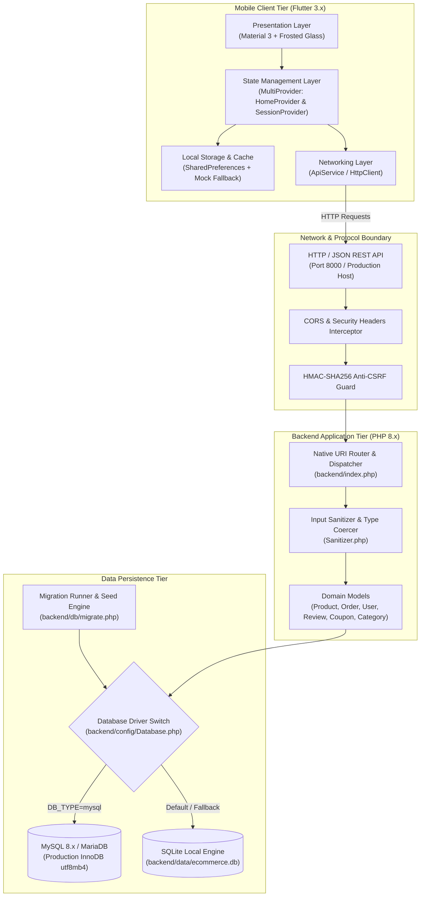
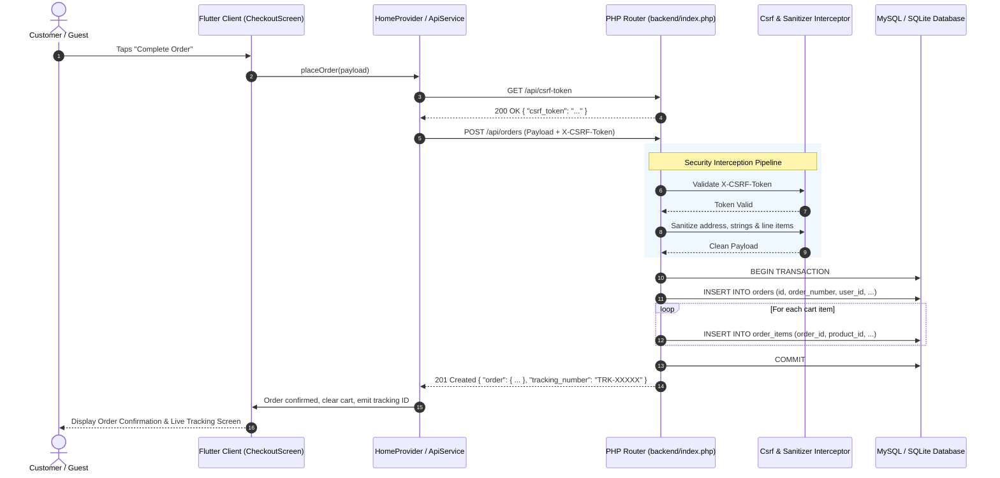

# 01. System Architecture & Component Design

## 1. Executive Summary

**LuxeCart** is a modern luxury mobile e-commerce platform built using a decoupled client-server architecture:
- **Frontend Client**: High-performance mobile application engineered in **Flutter (Dart 3.x)**, utilizing **Material 3**, custom **frosted glassmorphism design tokens**, and reactive state management powered by **Provider**.
- **Backend Service**: Lightweight, modular **PHP 8.x** REST API featuring custom routing, active-record data models, parameter-bound PDO transactions, and enterprise-grade security interceptors (CSRF token verification, XSS sanitization, and Bcrypt password hashing).
- **Dual-Engine Persistence Layer**: Primary support for **MySQL 8.x / MariaDB** (InnoDB, utf8mb4) with an automated zero-config fallback to **SQLite 3**, backed by an atomic versioned migration runner.

---

## 2. High-Level Tier Architecture



---

## 3. Tier Breakdown & Responsibilities

### 3.1 Mobile Client Tier (Flutter)
The frontend application follows clean architecture principles with distinct layer separation:
- **Presentation (`lib/presentation/`)**: Decoupled screens and reusable widgets conforming to luxury aesthetic tokens. Screens listen to reactive state providers without embedding business logic.
- **State Layer (`lib/providers/`)**:
  - [`SessionProvider`](file:///d:/YEAR%20IV/SEMESTER%20I/MA-II/Final_term/se_shop_e_commerce_app/lib/providers/session_provider.dart): Controls user authentication, token storage, guest sessions, and user-scoped data switching.
  - [`HomeProvider`](file:///d:/YEAR%20IV/SEMESTER%20I/MA-II/Final_term/se_shop_e_commerce_app/lib/providers/home_provider.dart): Orchestrates the catalog, live ticking deals timer, shopping bag calculations, shipping tier progress, emoji wishlist boards, and order tracking.
- **Data Layer (`lib/data/`)**:
  - [`ApiService`](file:///d:/YEAR%20IV/SEMESTER%20I/MA-II/Final_term/se_shop_e_commerce_app/lib/data/services/api_service.dart): Manages HTTP lifecycle, CSRF header attachment, serialization, error unwrapping, and fallback triggers.
  - [`LocalStorageService`](file:///d:/YEAR%20IV/SEMESTER%20I/MA-II/Final_term/se_shop_e_commerce_app/lib/data/services/local_storage_service.dart): Key-value persistent storage partitioned by user identity (`guest` vs authenticated user ID).

### 3.2 Backend Service Tier (PHP 8.x)
The backend uses a lightweight single-entry front controller architecture ([`backend/index.php`](file:///d:/YEAR%20IV/SEMESTER%20I/MA-II/Final_term/se_shop_e_commerce_app/backend/index.php)) avoiding bulky framework overhead:
- **Routing Engine**: Parses normalized HTTP request URIs and methods with regex pattern matching (`api/products/{id}`).
- **Security Interceptors**:
  - `SecurityHeaders`: Emits Content Security Policy (CSP), X-Frame-Options (`DENY`), X-XSS-Protection, and X-Content-Type-Options (`nosniff`).
  - `Cors`: Restricts and handles pre-flight `OPTIONS` requests and allowed headers (`Content-Type`, `X-CSRF-Token`, `Authorization`).
  - `Csrf`: Cryptographically verifies HMAC-SHA256 tokens for state-modifying requests (`POST`, `PUT`, `DELETE`).
- **Domain Models (`backend/models/`)**: Active Record pattern implementations encapsulating validation and SQL queries with strictly bound parameters.

### 3.3 Data Persistence Tier
- **Primary: MySQL 8.x**:
  - Character set: `utf8mb4`, Collation: `utf8mb4_unicode_ci`.
  - Storage Engine: InnoDB with ACID transactional support.
  - Foreign Key constraints with `ON DELETE CASCADE` on child tables (`order_items`, `wishlist_items`, `reviews`).
- **Fallback: SQLite 3**:
  - Zero-configuration local database stored in `backend/data/ecommerce.db`.
  - Automatically activated if MySQL environment variables are unconfigured or if the MySQL daemon is offline.

---

## 4. End-to-End Request & Data Flow

The following sequence diagram illustrates an order creation flow, demonstrating CSRF verification, input sanitization, database persistence, and client synchronization:



---

## 5. Resilience & High-Availability Mechanics

### 5.1 Offline-First Client Failover
Mobile devices frequently experience intermittent connectivity. LuxeCart implements dual-layer fallback resilience in [`ApiService`](file:///d:/YEAR%20IV/SEMESTER%20I/MA-II/Final_term/se_shop_e_commerce_app/lib/data/services/api_service.dart):
1. **Network Probe**: On initial boot, `fetchProducts()` attempts an HTTP `GET` request to `http://localhost:8000/api/products` (or configured remote host).
2. **Graceful Failover**: If the network times out, connection is refused, or an HTTP 5xx occurs:
   - The error is logged internally without crashing the UI.
   - The client seamlessly loads the 50 pre-packaged catalog products from [`MockData.products`](file:///d:/YEAR%20IV/SEMESTER%20I/MA-II/Final_term/se_shop_e_commerce_app/lib/data/mock/mock_data.dart).
   - An offline banner/indicator is raised in state, ensuring 100% browsing, cart addition, and exploration continuity.

### 5.2 Dynamic Database Fallback Engine
In [`backend/config/Database.php`](file:///d:/YEAR%20IV/SEMESTER%20I/MA-II/Final_term/se_shop_e_commerce_app/backend/config/Database.php):
```
Connection Attempt (DB_TYPE = mysql)
       │
       ├──► [SUCCESS] ──► Return PDO MySQL Connection
       │
       └──► [FAILURE / Offline]
                 │
                 ├──► Catch PDOException
                 └──► Auto-fallback to SQLite (backend/data/ecommerce.db)
```
This guarantees that evaluators or developers without a running MySQL instance can test the backend seamlessly out-of-the-box.

---

## 6. Security Architecture & Threat Model

| Security Dimension | Implementation Mechanism | Threat Mitigated |
|---|---|---|
| **SQL Injection (SQLi)** | 100% PDO prepared statements with explicit type binding across all models (`Product`, `Order`, `User`). No dynamic SQL string concatenation. | Data exfiltration, unauthorized database mutations, and SQL injection bypass. |
| **Cross-Site Request Forgery (CSRF)** | HMAC-SHA256 signed tokens (`Csrf::generateToken()`, `Csrf::validateToken()`). Validated via `X-CSRF-Token` header on state-changing endpoints. | Unauthorized transactions from external origins or malicious web views. |
| **Cross-Site Scripting (XSS)** | Recursive input sanitization via `Sanitizer::cleanString()` and `htmlspecialchars()` encoding. Strict CSP headers. | Malicious JavaScript injection via review comments or shipping address fields. |
| **Credential Protection** | One-way salted password hashing via `password_hash($pwd, PASSWORD_DEFAULT)` (Bcrypt). Passwords never stored or returned in plaintext. | Database leak credential exposure, rainbow table attacks. |
| **Cross-Origin Security** | Controlled CORS interceptor (`Cors.php`) responding only to authorized headers and methods. | Malicious third-party origin script access. |
