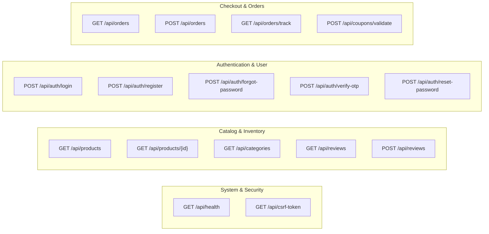

# 02. REST API Reference & Specification

## 1. Overview & Conventions

The LuxeCart Backend exposes a high-performance, stateless RESTful HTTP API. All communications use JSON payloads and standard HTTP status codes.

- **Base URL**: `http://localhost:8000/api` (or `http://<LAN-IP>:8000/api` for physical mobile devices)
- **Character Encoding**: `UTF-8`
- **Standard Content-Type**: `application/json`
- **State-Modifying Protection**: Anti-CSRF verification enforced via `X-CSRF-Token` header.

---

## 2. HTTP Status Code Conventions

| Status Code | Meaning | Usage Scenario |
|---|---|---|
| `200 OK` | Success | Successful `GET` requests, authenticated login, validated promo codes. |
| `201 Created` | Resource Created | Successful user registration, new order placed, review submitted. |
| `400 Bad Request` | Invalid Request | Missing required query parameters (e.g. tracking number, product ID). |
| `401 Unauthorized` | Unauthorized | Missing or invalid user credentials. |
| `403 Forbidden` | Forbidden / CSRF Invalid | Missing or forged `X-CSRF-Token` header on mutation requests. |
| `404 Not Found` | Resource Not Found | Unmatched route, non-existent product ID, or invalid coupon code. |
| `422 Unprocessable` | Validation Failure | Payload failed validation (e.g. blank password, empty cart items). |
| `500 Server Error` | Internal Server Error | Uncaught database exception or server fault (cleanly wrapped in JSON). |

---

## 3. Security & Header Specifications

### 3.1 Standard Headers
```http
Accept: application/json
Content-Type: application/json
```

### 3.2 Anti-CSRF Token Header
For all state-changing HTTP requests (`POST`, `PUT`, `DELETE`), the client must supply the cryptographically signed CSRF token obtained from `GET /api/csrf-token`:
```http
X-CSRF-Token: 3a9f4c8e1b2d3e4f...
```
If missing or invalid on protected routes, the server responds with:
```json
{
  "status": "error",
  "message": "CSRF verification failed: Missing or invalid token."
}
```

---

## 4. Complete Endpoint Catalog



---

### 4.1 System & Health

#### `GET /api/health`
Verifies backend connectivity, active security shields, and returns an endpoint index.

- **Request**: No parameters.
- **Response `200 OK`**:
```json
{
  "status": "online",
  "app": "LuxeCart SE Shop REST API",
  "security": {
    "xss_protection": "Sanitizer + HTML Entity Encoding + CSP",
    "csrf_protection": "HMAC-SHA256 Signed Tokens + Token Verification",
    "sql_injection_protection": "PDO Prepared Statements with Param Binding",
    "password_hashing": "Bcrypt / PASSWORD_DEFAULT"
  },
  "timestamp": "2026-09-07T10:00:00+00:00",
  "endpoints": { ... }
}
```

---

#### `GET /api/csrf-token`
Generates an anti-CSRF token signed with the application server key.

- **Request**: No parameters.
- **Response `200 OK`**:
```json
{
  "csrf_token": "a18e907d4b6c3e7f912450ba8dc2910fae120894cb3d...",
  "expires_in": 86400
}
```

---

### 4.2 Products & Catalog

#### `GET /api/products`
Retrieves products with optional category, search, and pagination filters.

- **Query Parameters**:
  - `category` *(optional, string)*: Filter by category (e.g. `Apparel`, `Electronics`, `Footwear`, `Accessories`, `Bags`, `Fine Jewelry`).
  - `search` *(optional, string)*: Case-insensitive search keyword against product name and brand.
  - `limit` *(optional, int, default: 50)*: Number of items to return.
  - `offset` *(optional, int, default: 0)*: Pagination offset.
- **Response `200 OK`**:
```json
{
  "data": [
    {
      "id": 1,
      "name": "Cashmere Knit Hoodie",
      "brand": "Aura Studios",
      "price": 64.99,
      "original_price": 89.99,
      "category": "Apparel",
      "image_url": "https://images.unsplash.com/photo-1556905055-8f358a7a47b2?w=800&q=80",
      "rating": 4.9,
      "reviews_count": 128,
      "description": "Ultra-soft Mongolian cashmere knit with tailored ribbed cuffs and kangaroo pocket.",
      "sizes": ["XS", "S", "M", "L", "XL"],
      "colors": ["Oatmeal", "Slate Gray", "Midnight Black"],
      "specs": {
        "Material": "100% Grade-A Cashmere",
        "Origin": "Ulaanbaatar, Mongolia",
        "Care": "Dry clean or hand wash cold"
      },
      "badge": "SALE",
      "in_stock": 1
    }
  ],
  "count": 1,
  "category": "Apparel",
  "search": null
}
```

---

#### `GET /api/products/{id}`
Retrieves full details for a single product.

- **URL Parameter**: `id` *(integer, required)*
- **Response `200 OK`**: Returns single product object matching the schema above.
- **Response `404 Not Found`**:
```json
{
  "status": "error",
  "message": "Product not found"
}
```

---

#### `GET /api/categories`
Retrieves the 6 curated luxury product categories.

- **Response `200 OK`**:
```json
[
  {
    "id": "apparel",
    "name": "Apparel",
    "icon": "checkroom_rounded",
    "description": "Tailored luxury garments & cashmere knitwear",
    "accent_color": "0xFFFF2D6F",
    "badge": "Trending"
  },
  {
    "id": "footwear",
    "name": "Footwear",
    "icon": "roller_skating_rounded",
    "description": "Handcrafted leather sneakers and boots",
    "accent_color": "0xFFFF6B00",
    "badge": "Hot"
  }
]
```

---

### 4.3 Authentication & Password Management

#### `POST /api/auth/login`
Authenticates an existing user and returns an account profile with session token.

- **Headers**: `Content-Type: application/json`
- **Request Body**:
```json
{
  "email": "emma.wills@email.com",
  "password": "password123"
}
```
- **Response `200 OK`**:
```json
{
  "id": "usr_demo_1001",
  "name": "Emma Wills",
  "email": "emma.wills@email.com",
  "phone": "+1 (555) 234-5678",
  "avatar_url": "https://images.unsplash.com/photo-1534528741775-53994a69daeb?w=400&q=80",
  "token": "tok_3b8a1c9f...",
  "role": "customer"
}
```
- **Response `401 Unauthorized`**:
```json
{
  "status": "error",
  "message": "Invalid email or password."
}
```

---

#### `POST /api/auth/register`
Registers a new member account with salted password hashing.

- **Request Body**:
```json
{
  "name": "Sophia Laurent",
  "email": "sophia@example.com",
  "password": "SecurePassword123!",
  "phone": "+1 (555) 345-6789"
}
```
- **Response `201 Created`**: Returns created user profile and session token.
- **Response `422 Unprocessable Entity`**: If email is invalid or already registered.

---

#### `POST /api/auth/forgot-password`
Initiates a password reset flow by dispatching a 6-digit numeric OTP.

- **Request Body**:
```json
{
  "email": "emma.wills@email.com"
}
```
- **Response `200 OK`**:
```json
{
  "success": true,
  "message": "Password reset code sent to your email address.",
  "otp_code": "842109",
  "expires_in_minutes": 15
}
```

---

#### `POST /api/auth/verify-otp`
Validates the 6-digit reset code against unexpired tokens.

- **Request Body**:
```json
{
  "email": "emma.wills@email.com",
  "otp": "842109"
}
```
- **Response `200 OK`**:
```json
{
  "success": true,
  "message": "OTP verified successfully."
}
```

---

#### `POST /api/auth/reset-password`
Updates the user's password with Bcrypt hashing once the OTP is verified.

- **Request Body**:
```json
{
  "email": "emma.wills@email.com",
  "otp": "842109",
  "new_password": "NewLuxuryPassword2026!"
}
```
- **Response `200 OK`**:
```json
{
  "success": true,
  "message": "Password has been reset successfully. You may now sign in."
}
```

---

### 4.4 Orders & Checkout

#### `GET /api/orders`
Lists orders for the authenticated user or all demo orders.

- **Response `200 OK`**:
```json
[
  {
    "id": "ord_1001",
    "order_number": "ORD-2026-0001",
    "user_id": "usr_demo_1001",
    "total_amount": 144.98,
    "subtotal": 139.98,
    "shipping_fee": 5.00,
    "discount_amount": 0.00,
    "promo_code": null,
    "shipping_address": "742 Evergreen Terrace, Springfield, OR 97477",
    "payment_method": "Apple Pay",
    "status": "Out for Delivery",
    "tracking_number": "TRK-1000001",
    "created_at": "2026-09-06 14:30:00",
    "items": [
      {
        "id": 1,
        "product_id": 1,
        "product_name": "Cashmere Knit Hoodie",
        "product_image": "https://images.unsplash.com/photo-1556905055-8f358a7a47b2?w=800&q=80",
        "quantity": 1,
        "price": 64.99,
        "selected_size": "M",
        "selected_color": "Oatmeal"
      }
    ]
  }
]
```

---

#### `POST /api/orders`
Submits and persists an order with atomic line item insertion.

- **Headers**:
  - `Content-Type: application/json`
  - `X-CSRF-Token: <token>`
- **Request Body**:
```json
{
  "user_id": "usr_demo_1001",
  "shipping_address": "14 Market Street, Apt 4B, New York, NY 10001",
  "payment_method": "Visa •••• 4589",
  "subtotal": 114.98,
  "shipping_fee": 0.00,
  "discount_amount": 22.99,
  "total_amount": 91.99,
  "promo_code": "LUXE20",
  "items": [
    {
      "product_id": 1,
      "product_name": "Cashmere Knit Hoodie",
      "quantity": 1,
      "selected_size": "L",
      "selected_color": "Slate Gray",
      "price": 64.99
    }
  ]
}
```
- **Response `201 Created`**: Returns created order structure including generated `order_number` and `tracking_number`.

---

#### `GET /api/orders/track`
Retrieves live delivery milestones and courier details.

- **Query Parameters**: `tracking_number` *(string, required)* or `order_number` *(string)*
- **Example**: `GET /api/orders/track?tracking_number=TRK-1000001`
- **Response `200 OK`**:
```json
{
  "order_number": "ORD-2026-0001",
  "tracking_number": "TRK-1000001",
  "status": "Out for Delivery",
  "estimated_delivery": "Today by 4:30 PM",
  "courier": {
    "name": "Marcus King",
    "vehicle": "Mercedes Sprinter (Van #12)",
    "rating": 4.96,
    "phone": "+1 (555) 019-2834"
  },
  "milestones": [
    { "title": "Order Placed", "time": "Sep 06, 09:15 AM", "completed": true },
    { "title": "Processing at Hub", "time": "Sep 06, 02:45 PM", "completed": true },
    { "title": "Out for Delivery", "time": "Sep 07, 08:30 AM", "completed": true },
    { "title": "Delivered", "time": "Pending", "completed": false }
  ]
}
```

---

### 4.5 Reviews

#### `GET /api/reviews`
Fetches verified customer reviews for a given product.

- **Query Parameters**: `product_id` *(integer, required)*
- **Response `200 OK`**:
```json
[
  {
    "id": 1,
    "product_id": 1,
    "user_name": "Camille Dupont",
    "rating": 5.0,
    "comment": "The cashmere texture is pure perfection. Tailored fit yet incredibly warm.",
    "date": "2 days ago"
  }
]
```

---

#### `POST /api/reviews`
Submits a customer review. Automatically sanitizes HTML tags to protect against Stored XSS.

- **Headers**: `X-CSRF-Token: <token>`
- **Request Body**:
```json
{
  "product_id": 1,
  "user_name": "Emma Wills",
  "rating": 5.0,
  "comment": "Absolutely fabulous garment. Arrived in luxury packaging."
}
```
- **Response `201 Created`**:
```json
{
  "id": 12,
  "product_id": 1,
  "user_name": "Emma Wills",
  "rating": 5.0,
  "comment": "Absolutely fabulous garment. Arrived in luxury packaging.",
  "created_at": "2026-09-07 10:20:00"
}
```

---

### 4.6 Coupons & Promos

#### `POST /api/coupons/validate`
Validates a promotional discount code against minimum basket requirements.

- **Request Body**:
```json
{
  "code": "LUXE20",
  "subtotal": 120.00
}
```
- **Response `200 OK`**:
```json
{
  "valid": true,
  "code": "LUXE20",
  "discount_type": "percent",
  "discount_value": 20.0,
  "discount_amount": 24.00,
  "final_subtotal": 96.00,
  "message": "20% Luxury Welcome Discount Applied!"
}
```
- **Supported Promo Codes**:
  - `LUXE20`: 20% off entire order.
  - `SAVE10`: \$10 fixed cash discount (minimum order \$50).
  - `FREESHIP`: 100% shipping fee waiver.
