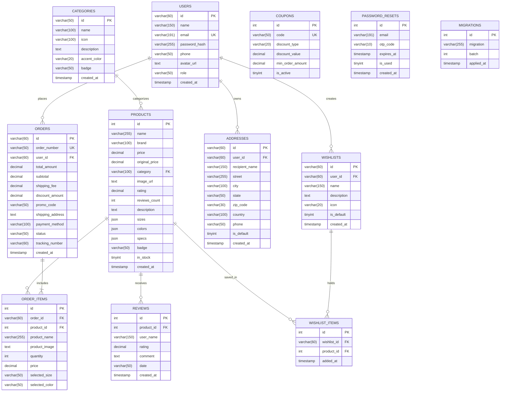

# 03. Database Architecture & Schema Specification

## 1. Overview

The LuxeCart data layer is architected for high transaction throughput, relational consistency, and zero-downtime schema evolution. It supports both **MySQL 8.x / MariaDB** (Production InnoDB) and **SQLite 3** (local / offline development).

- **Character Set**: `utf8mb4`
- **Collation**: `utf8mb4_unicode_ci`
- **Engine**: `InnoDB` (Foreign key enforcement, row-level locking, ACID transactions)
- **Migration Tracking**: Dedicated `migrations` table with batch rollback capability

---

## 2. Entity-Relationship Diagram (ERD)



---

## 3. Comprehensive Data Dictionary

### 3.1 `categories`
Stores product taxonomy, UI accent themes, and navigation icons.

| Column | Type | Nullable | Key | Default | Description |
|---|---|---|---|---|---|
| `id` | `VARCHAR(50)` | NO | PK | - | Category slug (e.g. `apparel`, `footwear`, `bags`). |
| `name` | `VARCHAR(100)` | NO | - | - | Display label (e.g. `Apparel`, `Fine Jewelry`). |
| `icon` | `VARCHAR(100)` | YES | - | `NULL` | Material icon identifier. |
| `description` | `TEXT` | YES | - | `NULL` | Short editorial summary for collection header. |
| `accent_color` | `VARCHAR(20)` | YES | - | `'0xFFFF2D6F'` | Hex/ARGB color token for UI category pills. |
| `badge` | `VARCHAR(50)` | YES | - | `NULL` | Optional trending badge (e.g. `Trending`, `Hot`). |
| `created_at` | `TIMESTAMP` | NO | - | `CURRENT_TIMESTAMP` | Row creation timestamp. |

---

### 3.2 `products`
The core catalog table housing 50 luxury product records, variant configurations, and specs.

| Column | Type | Nullable | Key | Default | Description |
|---|---|---|---|---|---|
| `id` | `INT` | NO | PK / AI | - | Unique product auto-increment ID. |
| `name` | `VARCHAR(255)` | NO | INDEX | - | Luxury item title. |
| `brand` | `VARCHAR(100)` | NO | - | - | Brand/Atelier name (e.g. *Aura Studios*, *Kuroki*). |
| `price` | `DECIMAL(10,2)`| NO | INDEX | - | Current selling price in USD. |
| `original_price`| `DECIMAL(10,2)`| YES| - | `NULL` | Prior price before markdown/sale. |
| `category` | `VARCHAR(100)` | NO | INDEX | - | Category foreign lookup (`Apparel`, `Electronics`). |
| `image_url` | `TEXT` | NO | - | - | CDN / Unsplash photography URL. |
| `rating` | `DECIMAL(3,1)` | YES | - | `5.0` | Calculated aggregate customer rating. |
| `reviews_count` | `INT` | YES | - | `0` | Total verified reviews tally. |
| `description` | `TEXT` | YES | - | `NULL` | In-depth product narrative and craftsmanship details. |
| `sizes` | `JSON` | YES | - | `NULL` | JSON array of available sizes `["S","M","L"]`. |
| `colors` | `JSON` | YES | - | `NULL` | JSON array of color swatches `["Black","Oatmeal"]`. |
| `specs` | `JSON` | YES | - | `NULL` | JSON key-value pairs of technical specs. |
| `badge` | `VARCHAR(50)` | YES | - | `NULL` | Visual tag (`NEW`, `SALE`, `BESTSELLER`). |
| `in_stock` | `TINYINT(1)` | YES | - | `1` | Inventory availability flag (`1` = yes, `0` = out). |
| `created_at` | `TIMESTAMP` | NO | - | `CURRENT_TIMESTAMP` | Catalog ingestion timestamp. |

---

### 3.3 `users`
Registered customer accounts and authentication credentials.

| Column | Type | Nullable | Key | Default | Description |
|---|---|---|---|---|---|
| `id` | `VARCHAR(60)` | NO | PK | - | User UUID / identifier (e.g. `usr_demo_1001`). |
| `name` | `VARCHAR(150)` | NO | - | - | Customer full legal/display name. |
| `email` | `VARCHAR(191)` | NO | UNIQUE | - | Unique login email address. |
| `password_hash`| `VARCHAR(255)` | NO | - | - | Salted Bcrypt password hash (`$2y$...`). |
| `phone` | `VARCHAR(50)` | YES | - | `NULL` | Contact phone number for delivery SMS alerts. |
| `avatar_url` | `TEXT` | YES | - | `NULL` | User profile photography avatar. |
| `role` | `VARCHAR(50)` | YES | - | `'customer'` | Authorization role (`customer`, `admin`). |
| `created_at` | `TIMESTAMP` | NO | - | `CURRENT_TIMESTAMP` | Registration date. |

---

### 3.4 `addresses`
Shipping destinations associated with customer accounts.

| Column | Type | Nullable | Key | Default | Description |
|---|---|---|---|---|---|
| `id` | `VARCHAR(60)` | NO | PK | - | Address identifier (`addr_101`). |
| `user_id` | `VARCHAR(60)` | YES | INDEX / FK | `NULL` | Associated user ID (`users.id`). |
| `recipient_name`| `VARCHAR(150)`| NO | - | - | Recipient contact name. |
| `street` | `VARCHAR(255)` | NO | - | - | Street address, suite/apartment number. |
| `city` | `VARCHAR(100)` | NO | - | - | City name. |
| `state` | `VARCHAR(50)` | NO | - | - | State, province, or region. |
| `zip_code` | `VARCHAR(30)` | NO | - | - | Postal / ZIP code. |
| `country` | `VARCHAR(100)` | YES | - | `'United States'` | Destination country. |
| `phone` | `VARCHAR(50)` | YES | - | `NULL` | Recipient contact phone. |
| `is_default` | `TINYINT(1)` | YES | - | `0` | Default selected delivery address flag. |
| `created_at` | `TIMESTAMP` | NO | - | `CURRENT_TIMESTAMP` | Address creation timestamp. |

---

### 3.5 `orders`
Master order records tracking payments, dispatch status, and shipping totals.

| Column | Type | Nullable | Key | Default | Description |
|---|---|---|---|---|---|
| `id` | `VARCHAR(60)` | NO | PK | - | Unique order ID (`ord_1001`). |
| `order_number` | `VARCHAR(50)` | NO | UNIQUE | - | Human-friendly order reference (`ORD-2026-0001`). |
| `user_id` | `VARCHAR(60)` | YES | INDEX | `'guest'` | Customer ID or `'guest'`. |
| `total_amount` | `DECIMAL(10,2)`| NO | - | - | Final charged amount after discounts and shipping. |
| `subtotal` | `DECIMAL(10,2)`| NO | - | - | Raw line items subtotal. |
| `shipping_fee` | `DECIMAL(10,2)`| YES | - | `0.00` | Applied delivery fee. |
| `discount_amount`| `DECIMAL(10,2)`| YES| - | `0.00` | Voucher discount subtracted from subtotal. |
| `promo_code` | `VARCHAR(50)` | YES | - | `NULL` | Applied coupon code (e.g. `LUXE20`). |
| `shipping_address`| `TEXT` | NO | - | - | Sanitized formatted delivery address. |
| `payment_method`| `VARCHAR(100)`| NO | - | - | Selected tender (`Visa •••• 4589`, `Apple Pay`). |
| `status` | `VARCHAR(50)` | YES | - | `'Processing'` | Current fulfillment status (`Processing`, `Out for Delivery`, `Delivered`). |
| `tracking_number`| `VARCHAR(60)` | YES | INDEX | `NULL` | Shipment tracking reference (`TRK-1000001`). |
| `created_at` | `TIMESTAMP` | NO | - | `CURRENT_TIMESTAMP` | Order placement timestamp. |

---

### 3.6 `order_items`
Line item records associated with orders, featuring cascading delete.

| Column | Type | Nullable | Key | Default | Description |
|---|---|---|---|---|---|
| `id` | `INT` | NO | PK / AI | - | Auto-increment line item ID. |
| `order_id` | `VARCHAR(60)` | NO | FK / INDEX| - | Foreign key referencing `orders.id` (`ON DELETE CASCADE`). |
| `product_id` | `INT` | NO | FK | - | Foreign key referencing `products.id`. |
| `product_name` | `VARCHAR(255)` | NO | - | - | Snapshot of product title at time of checkout. |
| `product_image`| `TEXT` | YES | - | `NULL` | Product thumbnail URL snapshot. |
| `quantity` | `INT` | NO | - | `1` | Ordered quantity count. |
| `price` | `DECIMAL(10,2)`| NO | - | - | Unit price locked at time of sale. |
| `selected_size`| `VARCHAR(50)` | YES | - | `NULL` | Chosen size variant (`M`, `L`, `42 EU`). |
| `selected_color`| `VARCHAR(50)`| YES | - | `NULL` | Chosen color swatch (`Midnight Black`). |

---

### 3.7 `reviews`
Verified customer feedback and star ratings per product.

| Column | Type | Nullable | Key | Default | Description |
|---|---|---|---|---|---|
| `id` | `INT` | NO | PK / AI | - | Unique review identifier. |
| `product_id` | `INT` | NO | FK / INDEX| - | Target product (`products.id`, `ON DELETE CASCADE`). |
| `user_name` | `VARCHAR(150)` | NO | - | - | Display name of reviewer. |
| `rating` | `DECIMAL(2,1)` | NO | - | - | Score from `1.0` to `5.0`. |
| `comment` | `TEXT` | NO | - | - | Sanitized review testimonial body. |
| `date` | `VARCHAR(50)` | YES | - | `NULL` | Relative or formatted date string. |
| `created_at` | `TIMESTAMP` | NO | - | `CURRENT_TIMESTAMP` | Review submission timestamp. |

---

### 3.8 `coupons`
Promotional discount codes, eligibility rules, and deduction logic.

| Column | Type | Nullable | Key | Default | Description |
|---|---|---|---|---|---|
| `id` | `INT` | NO | PK / AI | - | Unique coupon identifier. |
| `code` | `VARCHAR(50)` | NO | UNIQUE | - | Voucher uppercase code (`LUXE20`, `SAVE10`, `FREESHIP`). |
| `discount_type`| `VARCHAR(20)` | NO | - | - | Formula: `'percent'`, `'fixed'`, or `'freeship'`. |
| `discount_value`| `DECIMAL(10,2)`| NO | - | - | Numerical factor (`20.00` for 20%, `10.00` for \$10). |
| `min_order_amount`| `DECIMAL(10,2)`| YES| - | `0.00` | Minimum cart subtotal required to trigger. |
| `is_active` | `TINYINT(1)` | YES | - | `1` | Active voucher status toggle. |

---

### 3.9 `wishlists` & `wishlist_items`
Curated luxury emoji boards and member saved lists.

#### `wishlists`
| Column | Type | Nullable | Key | Default | Description |
|---|---|---|---|---|---|
| `id` | `VARCHAR(60)` | NO | PK | - | Wishlist UUID (`wsh_101`). |
| `user_id` | `VARCHAR(60)` | YES | INDEX | `NULL` | Member owner ID (`users.id`). |
| `name` | `VARCHAR(150)` | NO | - | - | Board name (e.g. *Paris Fashion Week*, *Tech Minimalist*). |
| `description` | `TEXT` | YES | - | `NULL` | Board theme description. |
| `icon` | `VARCHAR(20)` | YES | - | `'✨'` | Emoji board icon (`✨`, `🧥`, `💻`, `💎`). |
| `is_default` | `TINYINT(1)` | YES | - | `0` | Primary default wishlist indicator. |
| `created_at` | `TIMESTAMP` | NO | - | `CURRENT_TIMESTAMP` | Board creation timestamp. |

#### `wishlist_items`
| Column | Type | Nullable | Key | Default | Description |
|---|---|---|---|---|---|
| `id` | `INT` | NO | PK / AI | - | Record identifier. |
| `wishlist_id` | `VARCHAR(60)` | NO | FK / INDEX| - | Parent board ID (`wishlists.id`, `ON DELETE CASCADE`). |
| `product_id` | `INT` | NO | FK | - | Saved product ID (`products.id`, `ON DELETE CASCADE`). |
| `added_at` | `TIMESTAMP` | NO | - | `CURRENT_TIMESTAMP` | Date item was added to the board. |

---

### 3.10 `password_resets`
One-Time Passwords (OTP) generated during self-service account recovery.

| Column | Type | Nullable | Key | Default | Description |
|---|---|---|---|---|---|
| `id` | `INT` | NO | PK / AI | - | Record identifier. |
| `email` | `VARCHAR(191)` | NO | INDEX | - | Recipient email address. |
| `otp_code` | `VARCHAR(10)` | NO | INDEX | - | 6-digit numeric verification code. |
| `expires_at` | `TIMESTAMP` | NO | - | - | Expiration threshold (15 minutes from generation). |
| `is_used` | `TINYINT(1)` | YES | - | `0` | Consumption flag to prevent replay attacks. |
| `created_at` | `TIMESTAMP` | NO | - | `CURRENT_TIMESTAMP` | OTP generation timestamp. |

---

### 3.11 `migrations`
Batch and execution tracking for the database migration runner.

| Column | Type | Nullable | Key | Default | Description |
|---|---|---|---|---|---|
| `id` | `INT` | NO | PK / AI | - | Migration record ID. |
| `migration` | `VARCHAR(255)` | NO | UNIQUE | - | Migration filename base. |
| `batch` | `INT` | NO | - | - | Incremental batch run sequence number. |
| `applied_at` | `TIMESTAMP` | NO | - | `CURRENT_TIMESTAMP` | Execution completion timestamp. |

---

## 4. Migration Engine & CLI Commands

The LuxeCart migration engine ([`backend/db/MigrationRunner.php`](file:///d:/YEAR%20IV/SEMESTER%20I/MA-II/Final_term/se_shop_e_commerce_app/backend/db/MigrationRunner.php)) provides robust CLI tooling mirroring modern enterprise frameworks (e.g. Laravel / Rails).

### 4.1 CLI Commands

```bash
# 1. View current migration status (Applied vs Pending)
php backend/db/migrate.php status

# 2. Run all pending migrations
php backend/db/migrate.php up

# 3. Rollback the most recent migration batch
php backend/db/migrate.php rollback

# 4. Wipe all tables, rerun all 10 migrations, and seed 50 luxury products
php backend/db/migrate.php fresh --seed
```

### 4.2 Migration Registry

| File | Description | Rollback Target |
|---|---|---|
| `2026_01_01_000001_create_categories_table.php` | Creates `categories` table with UI accent color tokens. | `DROP TABLE categories` |
| `2026_01_01_000002_create_products_table.php` | Creates `products` table with JSON sizes/colors/specs. | `DROP TABLE products` |
| `2026_01_01_000003_create_users_table.php` | Creates `users` table with Bcrypt password storage. | `DROP TABLE users` |
| `2026_01_01_000004_create_addresses_table.php` | Creates `addresses` table linked to users. | `DROP TABLE addresses` |
| `2026_01_01_000005_create_orders_table.php` | Creates `orders` table with tracking & totals. | `DROP TABLE orders` |
| `2026_01_01_000006_create_order_items_table.php` | Creates `order_items` with cascading deletion. | `DROP TABLE order_items` |
| `2026_01_01_000007_create_reviews_table.php` | Creates `reviews` table linked to products. | `DROP TABLE reviews` |
| `2026_01_01_000008_create_coupons_table.php` | Creates `coupons` table (`LUXE20`, `SAVE10`, etc.). | `DROP TABLE coupons` |
| `2026_01_01_000009_create_wishlists_table.php` | Creates `wishlists` and `wishlist_items` tables. | `DROP TABLE wishlist_items, wishlists` |
| `2026_01_01_000010_create_password_resets_table.php`| Creates `password_resets` OTP verification table. | `DROP TABLE password_resets` |
