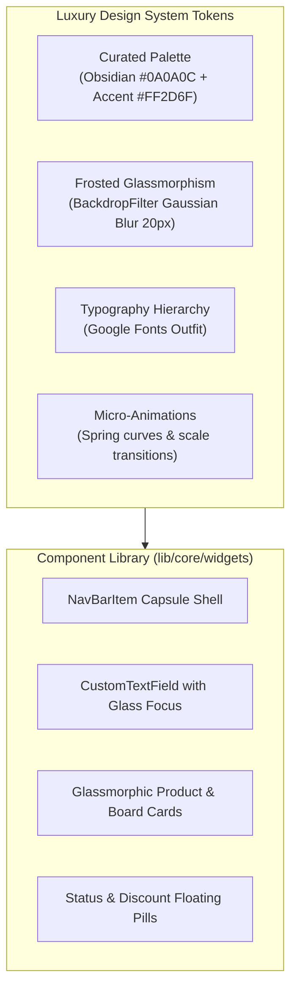
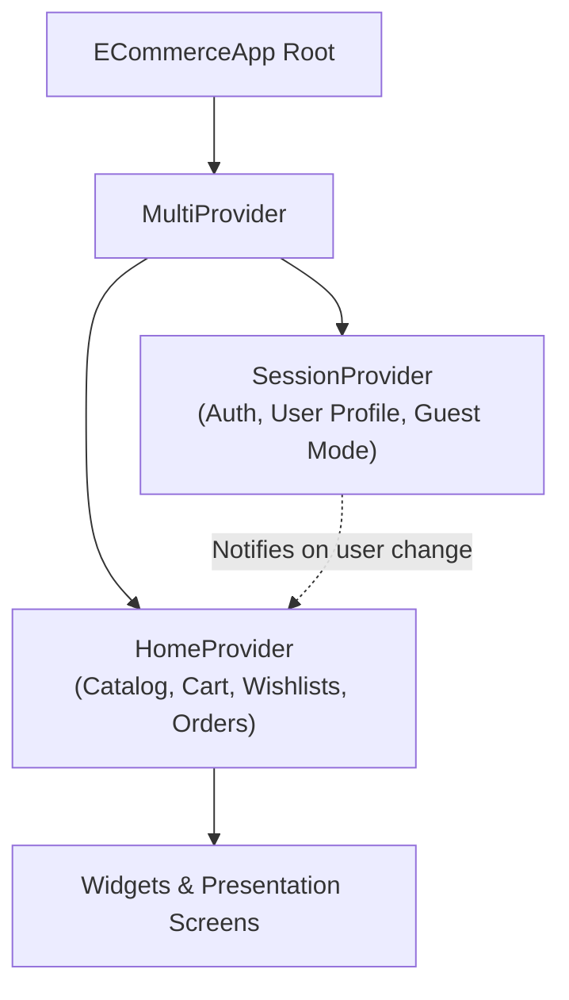
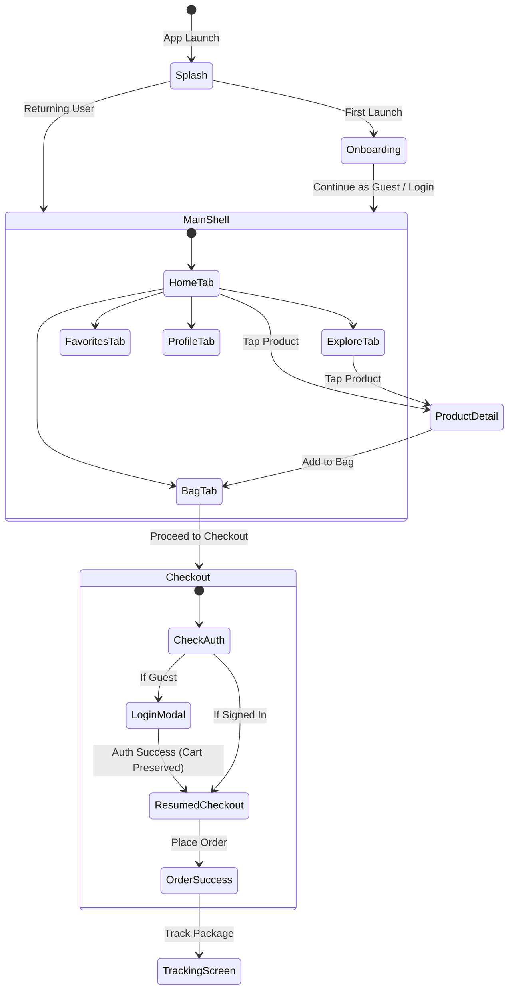

# 04. Mobile Client Architecture & Design System

## 1. Design Philosophy: Luxury Retail & Frosted Glassmorphism

The LuxeCart mobile application is designed to evoke the ambiance of an ultra-premium digital boutique. It blends **Google Material 3** specifications with bespoke **frosted glassmorphism**, fluid spring micro-interactions, and high-contrast typography.



---

## 2. Design System Tokens & Specs

### 2.1 Luxury Color Palette
The color scheme is defined in [`AppTheme`](file:///d:/YEAR%20IV/SEMESTER%20I/MA-II/Final_term/se_shop_e_commerce_app/lib/core/theme/app_theme.dart):

| Token Name | Hex / Value | Semantic Role |
|---|---|---|
| `scaffoldBackgroundColor` | `#0A0A0C` | Deep Obsidian background minimizing eye strain and highlighting imagery. |
| `surfaceColor` | `#151518` | Elevated card surfaces, bottom navigation dock, and sheet backgrounds. |
| `accentColor` | `#FF2D6F` | Primary luxury magenta/rose accent for primary CTAs, active pills, and badges. |
| `accentSecondary` | `#FF6B00` | Warm amber tone for flash deal timers, fire badges, and discounts. |
| `textPrimary` | `#FFFFFF` | High-contrast white for headers and emphasized titles. |
| `textSecondary` | `#9E9EA7` | Refined cool-gray for metadata, subtitles, and specifications. |
| `glassBorder` | `rgba(255,255,255,0.08)`| Subtle translucent stroke separating overlapping glass layers. |

### 2.2 Frosted Glassmorphism Specification
The floating navigation shell and modal sheets implement real-time blur shaders:
```dart
ClipRRect(
  borderRadius: BorderRadius.circular(28),
  child: BackdropFilter(
    filter: ImageFilter.blur(sigmaX: 20, sigmaY: 20),
    child: Container(
      decoration: BoxDecoration(
        color: const Color(0xFF151518).withOpacity(0.75),
        borderRadius: BorderRadius.circular(28),
        border: Border.all(color: Colors.white.withOpacity(0.08)),
      ),
      child: ...
    ),
  ),
)
```

### 2.3 Typography: Google Fonts `Outfit`
Typography utilizes the clean geometric cuts of the **Outfit** typeface:
- **Display 1** (`32px`, Bold `w800`, letter-spacing `-0.5`): Splash emblems and major promotion headings.
- **Title 1** (`22px`, SemiBold `w700`): Screen titles and product detail names.
- **Body Large** (`16px`, Medium `w500`): Form fields and primary button labels.
- **Caption** (`12px`, Regular `w400`, color `textSecondary`): SKU details, timestamps, and reviews.

---

## 3. State Management Architecture

LuxeCart leverages reactive declarative state management using **Provider** with two central orchestrators registered in [`app_providers.dart`](file:///d:/YEAR%20IV/SEMESTER%20I/MA-II/Final_term/se_shop_e_commerce_app/lib/app/app_providers.dart).



---

### 3.1 `SessionProvider`
Responsible for the user lifecycle and authentication boundaries:
- **Authentication States**:
  - `isSignedIn`: Boolean flag indicating whether the user is authenticated.
  - `isGuest`: Explicit flag allowing immediate browsing without mandatory account registration.
- **Session Persistence**: Encapsulates `SharedPreferences` for remembering credentials, active auth tokens, and member profiles.
- **Scoped User Cache Isolation (`switchUserScope()`)**:
  - When switching between guest mode and an authenticated account, `switchUserScope(userId)` resets or restores the respective user's cart, addresses, favorites, and custom wishlist boards to prevent data leakage between accounts.

---

### 3.2 `HomeProvider`
The primary operational state engine powering retail interactions:
- **Dynamic Catalog Filtering**:
  - Instant multi-faceted filtering across category slugs, price thresholds, and search strings.
  - Automatic fallback between live API responses and offline `MockData`.
- **Live Flash Deals Timer**:
  - Internal 1-second interval timer computing ticking hours, minutes, and seconds until the midnight deal refresh, triggering synchronized UI micro-animations.
- **Shopping Bag & VIP Shipping Bar**:
  - Atomic cart modifications (increment, decrement, remove, variant swap).
  - Real-time subtotal, discount, and tax computation.
  - **Free Shipping Progress Bar**: Dynamically calculates dollar progress toward the **\$100 VIP Free Shipping** threshold (`progress = min(1.0, subtotal / 100.0)`).
- **Dual Favorites & Emoji Wishlist Boards**:
  - `favorites`: Fast 1-tap liked product set.
  - `wishlists`: Custom emoji-themed boards (e.g. `✨ Runway Picks`, `🕶️ Summer Essentials`). Supports **1-Tap Add Board to Cart**.
- **Order Placement & Tracking**:
  - Asynchronously executes checkout via `ApiService`.
  - Dispatches orders and coordinates live driver tracking updates.

---

## 4. Screen Inventory & User Journeys



---

### 4.1 Screen Breakdown

| Screen Directory | Primary Widgets | Key Features |
|---|---|---|
| [`presentation/splash`](file:///d:/YEAR%20IV/SEMESTER%20I/MA-II/Final_term/se_shop_e_commerce_app/lib/presentation/splash) | `SplashScreen` | Animated glowing brand emblem, version tag (`v2.4.0 • SE Final 2026`), automated delay route transition. |
| [`presentation/onboarding`](file:///d:/YEAR%20IV/SEMESTER%20I/MA-II/Final_term/se_shop_e_commerce_app/lib/presentation/onboarding) | `OnboardingScreen` | 3-slide high-fashion carousel, animated pill page indicator, *Continue as Guest* and *Sign In* actions. |
| [`presentation/home`](file:///d:/YEAR%20IV/SEMESTER%20I/MA-II/Final_term/se_shop_e_commerce_app/lib/presentation/home) | `HomeScreen`, `FlashDealsBanner` | Hero carousel, live ticking flash deal countdown, category chips, curated recommendations. |
| [`presentation/explore`](file:///d:/YEAR%20IV/SEMESTER%20I/MA-II/Final_term/se_shop_e_commerce_app/lib/presentation/explore) | `ExploreScreen` | Instant debounce search bar, category chips filter, grid view with quick-favorite toggles. |
| [`presentation/product_detail`](file:///d:/YEAR%20IV/SEMESTER%20I/MA-II/Final_term/se_shop_e_commerce_app/lib/presentation/product_detail) | `ProductDetailScreen` | High-res gallery hero, size selector pills, color swatches, technical specs accordion, verified reviews list. |
| [`presentation/cart`](file:///d:/YEAR%20IV/SEMESTER%20I/MA-II/Final_term/se_shop_e_commerce_app/lib/presentation/cart) | `CartScreen`, `CheckoutScreen` | Free shipping threshold progress bar, promo code validation pill, 4-step accordion checkout, auth-gated safety prompt. |
| [`presentation/favorite`](file:///d:/YEAR%20IV/SEMESTER%20I/MA-II/Final_term/se_shop_e_commerce_app/lib/presentation/favorite) | `FavoriteScreen` | Tabbed view between quick Favorites and Curated Wishlist Boards with modal board creator and *Add Board to Cart*. |
| [`presentation/orders`](file:///d:/YEAR%20IV/SEMESTER%20I/MA-II/Final_term/se_shop_e_commerce_app/lib/presentation/orders) | `OrderListScreen`, `OrderTrackingScreen` | Order history cards, status pills, milestone timeline tracker, courier profile card (*Marcus King*) with 1-tap call action. |
| [`presentation/account`](file:///d:/YEAR%20IV/SEMESTER%20I/MA-II/Final_term/se_shop_e_commerce_app/lib/presentation/account) | `ProfileScreen`, `LoginScreen`, `RegisterScreen`, `ForgotPasswordScreen` | Member stats, address manager, password recovery flow with OTP verification, dark mode preferences. |

---

## 5. Seamless Auth-Gated Checkout Flow

A major UX requirement in LuxeCart is zero friction for guest users:
1. A guest user can freely browse, customize sizes, apply coupons (`LUXE20`), and build a shopping bag without logging in.
2. Upon tapping **Proceed to Checkout**, the app checks `sessionProvider.isSignedIn`.
3. If unauthenticated, a smooth bottom sheet prompts the user to **Sign In** or **Create Account**.
4. **Zero Data Loss**: Once authenticated, the user's cart contents and promo code remain fully intact in memory, and the app automatically transitions straight into `CheckoutScreen` without requiring the user to rebuild their bag.
